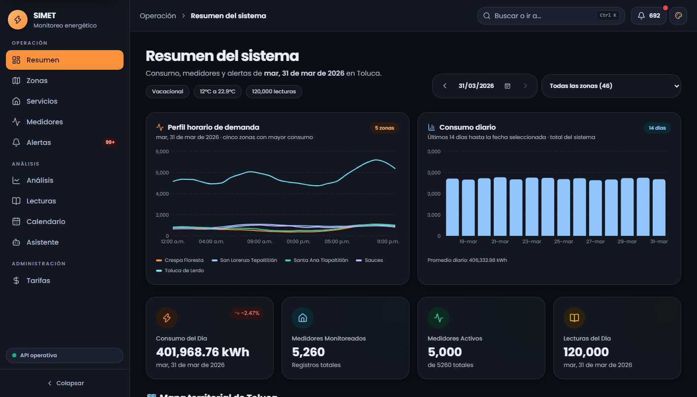
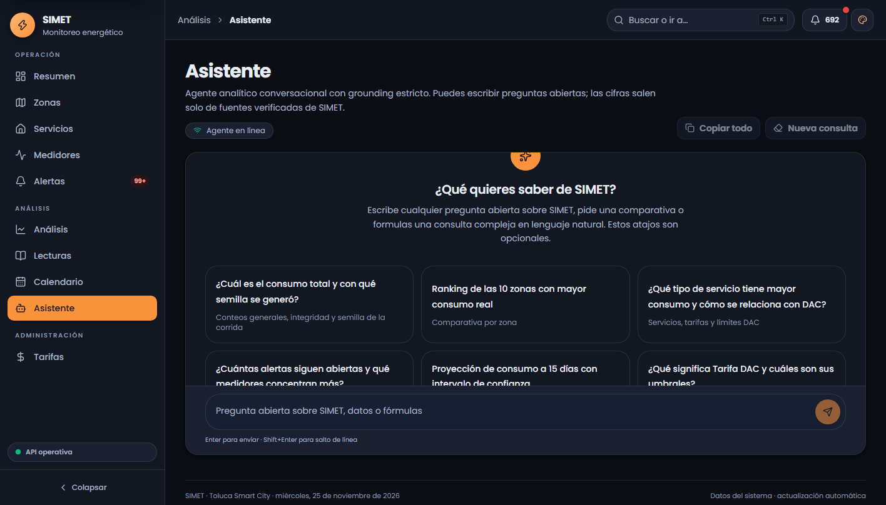
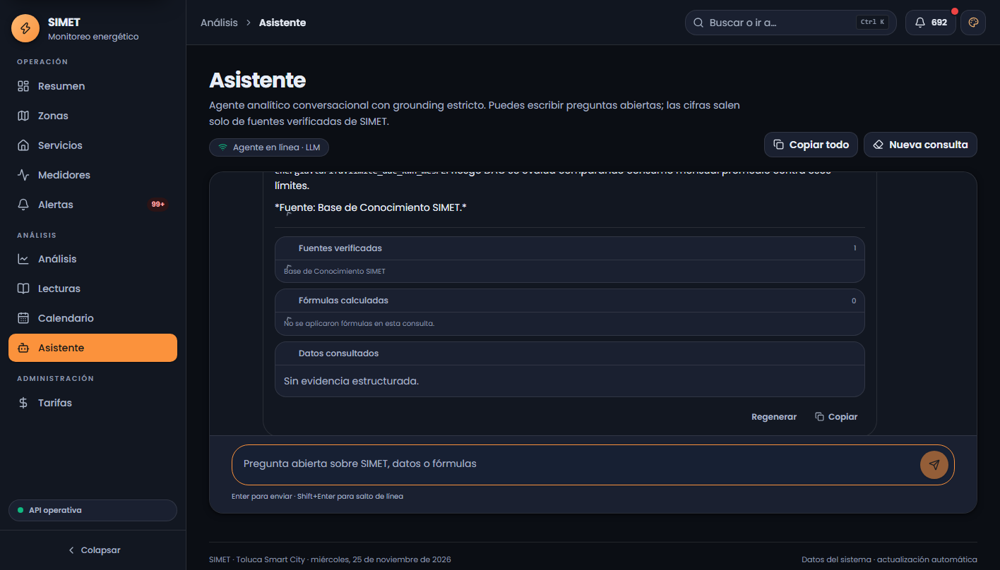
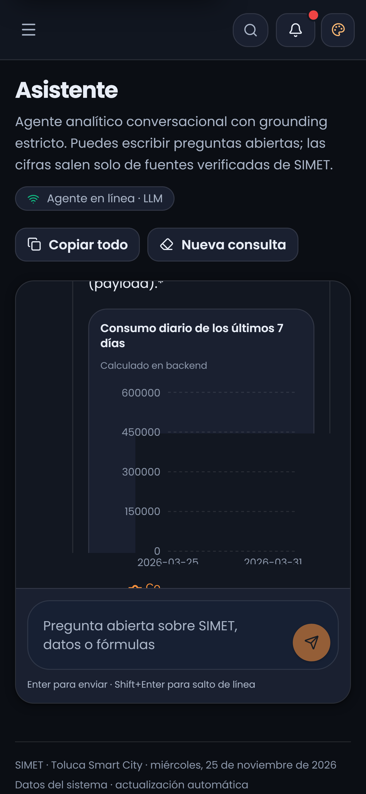

# Corpus operativo SIMET: navegación, acceso y modelos

**Mateo**  
**25 de noviembre de 2026**

## 1. Base operativa

SIMET es la capa de aplicación del proyecto HyperDataSynthetic. Consiste en un panel web y una API que consultan consumo eléctrico urbano sintético almacenado en PostgreSQL. El panel no genera datos: los consume.

El data engine es dueño del esquema `energia`, de los catálogos y del volumen de datos. Este repositorio es dueño de la interfaz y de la API. Si una tarea implica modificar una tabla, la pregunta correcta es si el data engine ya la define así. No se cambia el DDL local para compensar un modelo nuevo.

El juego de datos canónico cubre del 1 de enero al 31 de marzo de 2026: 90 días de lecturas horarias, 46 zonas de Toluca, 5,000 servicios, 5,000 medidores activos, 10,800,000 lecturas y semilla `20260103`. El catálogo registra 5,260 medidores porque incluye 260 unidades de reemplazo. Todo el conjunto es sintético y debe etiquetarse como tal. La ventana de tres meses es el periodo documentado. No hay política de retención ni autorización para borrar registros.

La arquitectura es la siguiente:

```text
Navegador React 19 + TypeScript + Vite 8 + Tailwind 4       127.0.0.1:8443
        | HTTP/JSON
FastAPI + SQLAlchemy 2                                       127.0.0.1:8000
        | psycopg 3
PostgreSQL, esquemas energia y datamart
```

El agente debe ayudar a navegar, explicar conceptos, ejecutar herramientas verificadas, citar fuentes y separar dato observado de estimación. No inventa cifras, no usa conocimiento externo, no propone cambios de esquema en este repositorio y no muestra credenciales. Trabaja en español con formato `es-MX`.



*Figura 1. Vista de Resumen, punto de entrada habitual del panel.*

## 2. Reglas de rutas

En este documento, «puertas» significa tres cosas: rutas de navegación, accesos y permisos de API, y compuertas de calidad. Esta sección cubre la primera.

La navegación usa hash, sin React Router. `src/navigation.ts` declara `PAGE_ROUTES`, `pageFromRoute()`, `getPageFromLocation()` y `routeHash()`. `getPageFromLocation()` lee primero el hash y después el `pathname`. Si no hay coincidencia, abre Resumen. El uso de hash permite recargar en alojamiento estático sin reglas de reescritura.

| Clave | Ruta | Grupo | Función |
|---|---|---|---|
| `dashboard` | `#/resumen` | Operación | Estado general, consumo del día, mapa y alertas recientes |
| `zonas` | `#/zonas` | Operación | Indicadores territoriales, ranking y estado de medición |
| `hogares` | `#/servicios` | Operación | Servicios registrados, medidores asociados y carga contratada |
| `medidores` | `#/medidores` | Operación | Inventario, estado, calidad de enlace y alertas |
| `alertas` | `#/alertas` | Operación | Prioridades, seguimiento y vínculo con medidores |
| `analisis-energetico` | `#/analisis` | Análisis | Curvas horarias, comparación mensual, perfil y mapa de calor |
| `historial-lecturas` | `#/lecturas` | Análisis | Historial, calidad del dato, huecos y exportación CSV |
| `calendario-energetico` | `#/calendario` | Análisis | Festivos, temperatura y factor estacional |
| `tarifas` | `#/tarifas` | Administración | Catálogo tarifario, límite DAC y servicios asignados |
| `asistente` | `#/asistente` | Análisis | Consultas informativas, datos verificados y fórmulas |

Reglas para agregar una página: extender el tipo `Page`, añadir la entrada a `NAV_ITEMS`, agregar el slug a `PAGE_ROUTES` y añadir el caso al `switch` de `App.tsx`. Los componentes consumen clientes en `src/services/`. Salvo `Zones.tsx`, una pantalla no llama `fetch` directo. El tema arranca en oscuro y se controla desde `ThemeProvider`.

Cada pantalla debe mostrar estados de carga, error, vacío y reintento. Una respuesta fallida no se disfraza de dato vacío. El encabezado nombra la vista concreta, no solo el grupo al que pertenece.



*Figura 2. Estado inicial del asistente con sugerencias opcionales.*

## 3. Reglas de API y permisos

La base de la API es `/api` y la documentación interactiva está en `/docs`. El navegador usa `VITE_API_URL`; el backend usa `DATABASE_URL`. CORS autoriza solo los puertos 8443 y 5173 en `localhost` y `127.0.0.1`. Cambiar el puerto del frontend exite editar `main.py`, `vite.config.ts` y `.env.example` a la vez.

Hay doce routers registrados. `/api/calendario` y `/api/calendario-energetico` son recursos distintos: el primero alimenta Resumen; el segundo, Calendario. No se fusionan.

Convenciones que cambian el significado de una respuesta:

| Recurso | Regla real |
|---|---|
| `alerta` | No hay columna `estado`. Abierta significa `ts_cierre IS NULL`. `resultado` admite `CONFIRMADA`, `FALSO_POSITIVO` y `NO_CONCLUYENTE`. |
| `medidor` | `calidad_enlace` es un porcentaje de 50 a 100. `multiplicador` admite 1, 20, 40 u 80. |
| `perfil_carga_horaria` | `tipo_dia` vale `H`, `S` o `D`. No existen `LABORABLE` ni `FESTIVO`. |
| `calendario` | El festivo es el booleano `es_festivo`; `tipo_dia` sigue siendo H, S o D. |
| `lectura` | Está particionada por mes. Filtrar por `id_medidor` es mucho más rápido que filtrar solo por fecha. |
| `huecos` | El parámetro `intervalo_esperado_minutos` vale 60. |

El asistente exige `ASISTENTE_DATABASE_URL` con rol de solo lectura. No existe fallback a `DATABASE_URL`. El usuario puede pedir SQL y el plano puede declarar la herramienta `ejecutar_sql_lectura`, pero la capa SQL solo acepta una sentencia `SELECT` o `WITH` de hasta 2,000 caracteres, sin comentarios, sin múltiples sentencias y sin palabras de escritura. La salida se limita a 200 filas. Los parámetros se validan en `parametros.py` antes de ejecutarse. El LLM nunca recibe la conexión ni credenciales: elige herramientas declaradas y la ejecución ocurre en Python. La API general tiene operaciones de escritura en tarifas, pero el asistente nunca debe invocarlas.

Límites operativos del asistente: 30 consultas por minuto por IP y sesión, 10 consultas simultáneas y caché TTL de 600 segundos. El historial se guarda en el navegador, nunca en PostgreSQL.

## 4. Compuertas de calidad

Los criterios del proyecto exigen al menos 8 entidades, 10 millones de registros generados por programa propio, integridad referencial verificada, reproducibilidad por semillas, aplicación funcional, datamart, dashboards relevantes y documentación de usuario y técnica. El conjunto sintético debe etiquetarse como tal y deben documentarse las tasas de anomalía.

La validación disponible usa esquemas Pydantic, restricciones del esquema propiedad del data engine, reglas versionadas en `Rules/Rules.json` y `/api/datamart/validacion-integridad`. No se citan `core/rules.py`, `services/validation.py` ni `routers/validacion.py`: no existen.

Antes de cerrar un cambio se ejecuta:

```text
ven\Scripts\python.exe -m py_compile <archivos Python modificados>
cmd /c npx tsc --noEmit
cmd /c npm run build
POST real contra /api/asistente/consultar
```

También se revisa la interfaz en 1440x900 y 390x844 con escala 2, sin desbordamiento horizontal, con foco de teclado visible y con `prefers-reduced-motion`. Si `chrome-devtools` no está disponible, se reporta. No se afirma que se usó. El rendimiento se mide contra 10.8 millones de filas: un juego de 276 medidores esconde el problema.

Reglas de cierre del repositorio: no commits sin autorización, no borrado sin lista concreta y confirmación, respaldo previo a cualquier sobrescritura, y cada cambio verificable termina con el resultado de la comprobación ejecutada.

## 5. Modelo asistente

`POST /api/asistente/consultar` recibe `pregunta` e `historial`. La pregunta y cada mensaje miden entre 1 y 800 caracteres. Se conservan los últimos doce mensajes, es decir seis turnos. `GET /api/asistente/sugerencias` devuelve seis atajos opcionales, no una lista blanca.

La respuesta contiene `respuesta`, `fuentes`, `formulas_aplicadas`, `datos_visualizacion`, `modo`, `origen` y `aviso`, además de los campos de compatibilidad `fuente`, `metodo`, `datos` y `grafica`. La respuesta es Markdown de hasta 800 caracteres.

| Modo | Cuándo se usa | Origen |
|---|---|---|
| `conversacional` | Saludos, capacidades y agradecimientos | `local` |
| `conceptual` | Definiciones del glosario SIMET | `local` |
| `datos` | Consultas con herramientas o fórmulas verificadas | `llm` cuando redacta el proveedor, `local` si falla o no se configura |

Las respuestas locales no consumen tokens del proveedor y citan `Base de Conocimiento SIMET`. Nunca exponen rutas internas como `payload.resultado.respuesta_base`. La hora y la fecha se responden en local con el reloj del servidor y se citan como `reloj local del servidor SIMET`: son datos operativos básicos, no hechos del dominio ni conocimiento externo. La identidad del agente sale de `respuesta_identidad` y se cita como `Base de Conocimiento SIMET`. Si una pregunta combina identidad y hora, ambas se responden en el mismo turno con las dos fuentes. Las consultas con datos usan siete herramientas SQL verificadas: resumen del sistema, zonas, servicios y tarifas, alertas y medidores, serie diaria y horaria, agregados y `ejecutar_sql_lectura`. La octava herramienta es `calcular_formula`.

`consultar_agregados` calcula promedio, suma, mínimo, máximo o conteo sobre columnas permitidas de `datamart.dm_kpi_diarios`, con ventana opcional de 7, 15 o 30 días contada desde la última fecha observada. `ejecutar_sql_lectura` acepta `SELECT` o `WITH` del usuario, rechaza escritura, comentarios y múltiples sentencias, y devuelve hasta 200 filas con las fuentes detectadas. Ninguna de las dos permite `INSERT`, `UPDATE`, `DELETE`, `DROP` ni cambios de esquema.

Cuando preguntan por un pronóstico oficial o registrado, el chatbot responde de forma local: SIMET no almacena pronósticos oficiales y ofrece la serie observada o una estimación etiquetada. No presenta una extrapolación como dato guardado.

Las fórmulas permitidas son `factor_carga`, `proyeccion_tendencia`, `riesgo_dac`, `indice_perdidas_y_anomalias` y `evaluar_expresion_segura`. Cada cifra se cita con la vista o tabla del payload. Los temas ajenos e inyecciones devuelven `FUERA_DE_ALCANCE`. Sin evidencia se usa `SIN_EVIDENCIA`, sin rellenar con suposiciones. El redactor usa `REDACTOR_REDUCIDO` y un payload resumido de 4,000 caracteres. El historial se guarda solo en `simet-asistente-historial-v1`, con doce mensajes de 800 caracteres como máximo.



*Figura 3. Respuesta con gráfica, fuentes, fórmula y datos consultados.*

## 6. Modelo predictivo

El modelo vigente es `proyeccion_tendencia`. No se propone uno nuevo. Toma hasta 60 días de `consumo_total_kwh` de `datamart.dm_kpi_diarios`, aplica regresión lineal simple, calcula media móvil de siete días y construye una banda de predicción.

```text
ŷ = a + b·t
banda = ŷ ± 1.96·σ_residual·sqrt(1 + 1/n + h)
horizontes permitidos = 7, 15 o 30 días
```

Es una estimación, no un dato observado. La banda usa la desviación de los residuales y no debe describirse como intervalo de confianza de la media. Abril es posterior al 31 de marzo, por eso sus valores son proyección posterior a la última lectura observada, nunca lectura de abril.

La frase «Dame una predicción e consumo energético de abril porfavor» devolvió originalmente `sin evidencia suficiente`. El texto coloquial no cambia la intención: «e consumo» se entiende como «de consumo» y «porfavor» es cortesía. La causa raíz fue un timeout de 30 segundos en `estadisticas._serie_diaria`. La consulta seleccionaba `medidores_activos`, un `count(DISTINCT ...)` sobre 10.8 millones de filas en `datamart.dm_kpi_diarios`. El mensaje sobre tres días observados era el síntoma, no la causa.

La corrección tiene dos partes. Primero, `_serie_diaria` ya no selecciona `medidores_activos`: ninguna fórmula ni gráfica del asistente consume esa columna. Segundo, `_dias_solicitados` reconoce nombres de mes y devuelve 30 días, porque `DIAS_PERMITIDOS` es `(7, 15, 30)`. La rama numérica se evalúa antes, así que una petición explícita de siete días sigue devolviendo siete días.

Verificación ejecutada después del parche:

| Prueba | Resultado |
|---|---|
| Predicción de abril | 8,937 ms en la prueba original; con la honestidad vigente, `modo=datos`, `origen=llm`, `aviso="Estimación derivada; SIMET no almacena pronósticos oficiales."`, disponible `true` |
| Filas proyectadas | 30, del `2026-04-01` al `2026-04-30` |
| Fuentes | `datamart.dm_kpi_diarios` y `energia.perfil_carga_horaria` |
| Regresión a 7 días | 8,592 ms en la prueba original; 7 filas, del `2026-04-01` al `2026-04-07` |
| Promedio de consumo a 7 días | `consultar_agregados`, 405,453.87 kWh sobre 8 filas del `2026-03-24` al `2026-03-31` |
| SQL de solo lectura | `SELECT` sobre `datamart.dm_kpi_diarios`, 3 filas devueltas; `DELETE`, `DROP` y comentarios rechazados en validación |
| Pronóstico oficial | Respuesta local, sin llamada al proveedor, con `SIN_PRONOSTICO_OFICIAL` |

`origen=llm` es esperado: el plan fue local y el proveedor solo redactó un payload ya verificado. No se interpreta como fallo. No se añade índice, datamart ni modelo alternativo para resolver este caso. Restaurar `medidores_activos` reintroduce el timeout.



*Figura 4. Asistente en 390x844 con escala 2.*

## 7. Decisiones que no deben revertirse

- El asistente usa rol de solo lectura, sin fallback. El LLM solo elige herramientas declaradas y validadas.
- Ninguna respuesta usa conocimiento externo. Fuera de SIMET se responde `FUERA_DE_ALCANCE`.
- `riesgo_dac` compara el promedio del tipo de servicio contra cada límite tarifario. No atribuye consumo a un RPU ni a una tarifa individual.
- `proyeccion_tendencia` entrega banda de predicción. `indice_perdidas_y_anomalias` cuenta eventos de `dm_anomalias_zona`, no alertas de `energia.alerta`.
- `evaluar_expresion_segura` usa AST acotado, sin `eval`, llamadas ni importaciones.
- Respuestas locales sin LLM, cita canónica e historial local sanito a doce mensajes de 800 caracteres.
- `_chat` envía `User-Agent: curl/8.10.1`. Sin él, Groq responde Cloudflare 1010.
- `_perfil_horario` omite el parámetro cuando no hay filtro. `:tipo_servicio IS NULL` vuelve ambiguo `$1` con psycopg.
- `_serie_diaria` no incluye `medidores_activos`. `_dias_solicitados` infiere 30 días por nombre de mes.
- Toda extrapolación posterior a la última fecha observada lleva `aviso` de estimación derivada. SIMET no almacena pronósticos oficiales.
- `ejecutar_sql_lectura` solo acepta una sentencia `SELECT` o `WITH`, sin comentarios ni escritura, con límite de 200 filas. Nunca se permite `DELETE`, `DROP`, `ALTER` ni cambios de tablas.
- Las fórmulas nuevas entran por revisión y registro en `formulas.py`; no se extraen ni ejecutan en caliente desde internet.
- No React Router, no DDL local canónico, no borrar componentes heredados sin autorización.

## 8. Fuentes consultadas

- `README.md` y `AGENTS.md`.
- `Documentacion/RESUMEN_PROYECTO_SIMET.md` y `DOCUMENTACION_TECNICA.md`.
- `docs/data-engine/ANALISIS_Y_MEJORAS.md` y `ENTREGA_FINAL/02_Presentacion/HALLAZGOS_DATA_ENGINE_260926.md`.
- `ENTREGA_FINAL/01_Documentacion/Acta de Inicio (Project Charter) - HyperDataSynthetic - v3.0.pdf`.
- `docs/manual_usuario/MANUAL_USUARIO.md`.
- `src/navigation.ts`, `src/components/Asistente.tsx` y `src/services/asistenteService.ts`.
- `backend/app/main.py`, `backend/app/routers/asistente.py`, `backend/app/services/llm.py`, `estadisticas.py`, `formulas.py`, `parametros.py` y `conocimiento_simet.py`.
- `docs/sql/asistente_readonly.sql`.
